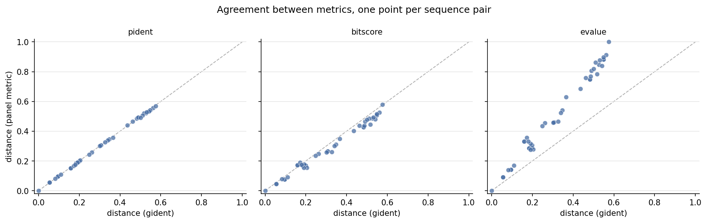
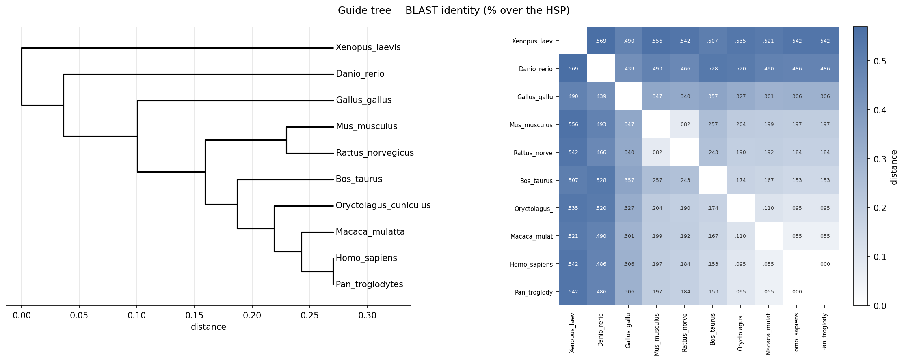
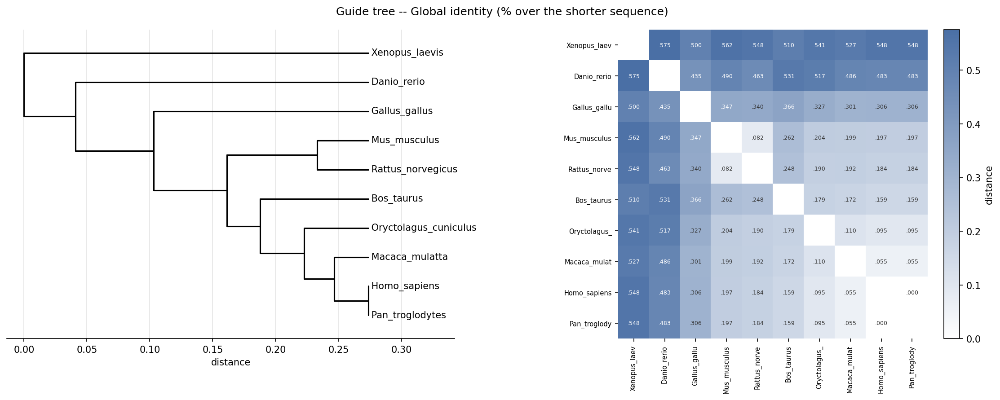
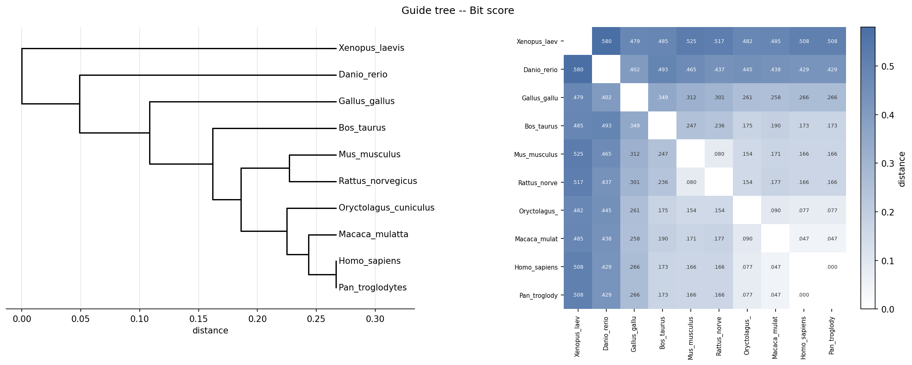
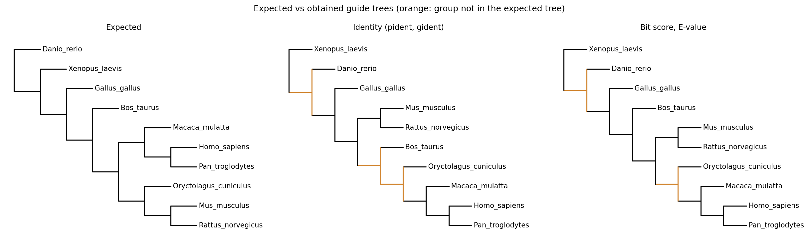
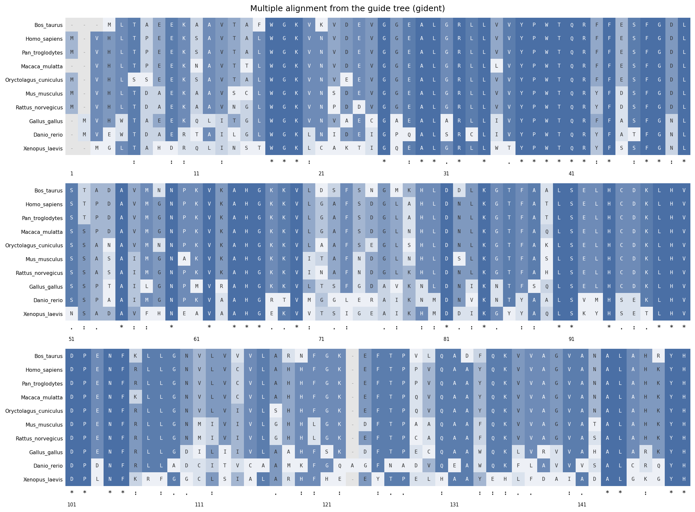

# Módulo 2B: árboles y alineamiento múltiple

Cada ejercicio se corre desde la raíz del proyecto con `python3 main.py <ejercicio>` (por ejemplo `python3 main.py 1-ii`); sin argumentos lista los que hay: `1-i`, `1-ii`, `1-sim`, `1-cmp`, `1-mat`, `2a`, `2b`, `3a` y `3b`. El código de cada ejercicio está en `exercises/` y las funciones compartidas en `sequences.py` (descarga y all-vs-all con BLAST), `matrices.py` (matrices, simetría, distancias y árbol guía), `msa.py` (alineamiento múltiple) y `plots.py` (figuras). Las secuencias y la salida de BLAST quedan cacheadas en `data/`; si se borran, la primera corrida las vuelve a generar.

Hacen falta BLAST+ (`brew install blast`) y, para el ejercicio 3, MAFFT (`brew install mafft`). BLAST corre local porque con `NCBIWWW.qblast` habría que encolar los 90 pares ordenados de a uno; local es un solo comando y tarda segundos.

---

## Datos

Usamos beta-globina, una entrada por especie, diez especies. Su filogenia es conocida, así que el árbol guía del ejercicio 2 tiene contra qué compararse, y la divergencia es gradual (identidades de 42% a 100%). El árbol esperado, el que estas diez deberían recuperar, es

```
(((((((humano, chimpancé), macaco), ((ratón, rata), conejo)), vaca), pollo), rana), pez cebra)
```

Los candidatos salen de la API REST de UniProt (`gene:hbb`, `reviewed:true`) y las diez entradas, fijas en `sequences.py`, son:

| Especie | Accession | Entry name | Largo | Por qué esta y no otra copia |
|---|---|---|---|---|
| *Homo sapiens* | P68871 | `HBB_HUMAN` | 147 | única beta adulta |
| *Pan troglodytes* | P68873 | `HBB_PANTR` | 147 | única beta adulta |
| *Macaca mulatta* | P02026 | `HBB_MACMU` | 146 | única beta adulta |
| *Mus musculus* | P02088 | `HBB1_MOUSE` | 147 | beta-major, adulta; sobre beta-2, H0, H1 y epsilon-Y2 |
| *Rattus norvegicus* | P02091 | `HBB1_RAT` | 147 | major-form, adulta; sobre beta-2 minor |
| *Oryctolagus cuniculus* | P02057 | `HBB_RABIT` | 147 | beta-1/2, única beta adulta revisada |
| *Bos taurus* | P02070 | `HBB_BOVIN` | 145 | única beta adulta |
| *Gallus gallus* | P02112 | `HBB_CHICK` | 147 | beta adulta; sobre las embrionarias |
| *Xenopus laevis* | P02132 | `HBB1_XENLA` | 146 | beta-major, adulta; sobre beta-2 y la larval |
| *Danio rerio* | Q90486 | `HBB1_DANRE` | 148 | beta-A1, adulta; sobre beta-A2 |

En varias especies hay más de una beta-globina: son copias del mismo gen que surgieron por duplicación. El ratón, por ejemplo, tiene cinco revisadas en UniProt (beta-1, beta-2, beta-H0, beta-H1 y epsilon-Y2), así que "la beta-globina del ratón" no la resuelve una búsqueda: hay que elegir. En todas las especies tomamos la cadena adulta principal, que UniProt anota como tal. Aun así, como las copias se duplicaron por separado en cada linaje, el árbol que sale de las secuencias es el de este gen y puede no coincidir con el de las especies, sobre todo en las ramas más cercanas a la raíz.

---

## Ejercicio 1

> **Ejercicio 1):** utilice lo aprendido en los trabajos prácticos previos (uso de biopython para obtener secuencias, BLAST y el “parser del mismo”) para: i) obtener 10 secuencias pertenecientes a una misma familia y ii) Alinearlas y obtener la correspondiente matriz de puntaje / identidad. Analice si la matriz es (o no) simetrica. Compare matrices utilizando diferentes puntajes que le otorga BLAST (Bit Score, Identidad, E-Value).

### i) Las diez secuencias

`python3 main.py 1-i` imprime, desde `data/globins.json` (lo que realmente se descargó), accession, entry name, largo y el motivo de la elección de cada una. Son diez secuencias de entre 145 y 148 aa (media 146,7), las de la tabla de **Datos**.

### ii) La matriz de puntaje / identidad

`python3 main.py 1-ii` corre un solo `blastp` con el mismo archivo como query y como subject, y BLAST hace las 100 comparaciones ordenadas (las 90 de secuencias distintas y las 10 de cada secuencia contra sí misma):

```bash
blastp -query data/globins.fasta -subject data/globins.fasta \
       -outfmt "6 qseqid sseqid pident length ... nident qlen slen qseq sseq" \
       -evalue 10000 -max_hsps 1
```

Los self-hits se conservan porque son la diagonal con la que se normaliza el bit score. Con `-evalue 10000` en vez del default 10 no se pierde ningún par distante, y con `-max_hsps 1` cada par aporta una sola fila. Los 100 pares alinearon, así que la matriz no tiene agujeros. El comando imprime las matrices de las cuatro métricas; acá van las dos que pide la consigna, identidad y puntaje, crudas: la fila es el query y la columna el subject, sin promediar. Los nombres van abreviados (Hsap = *H. sapiens*, Ptro = *P. troglodytes*, Mmul = *M. mulatta*, Mmus = *M. musculus*, Rnor = *R. norvegicus*, Ocun = *O. cuniculus*, Btau = *B. taurus*, Ggal = *G. gallus*, Xlae = *X. laevis*, Drer = *D. rerio*).

BLAST es un alineador local: devuelve el HSP (*high-scoring segment pair*, par de segmentos de puntaje alto), el tramo donde el puntaje no mejora ni extendiendo ni recortando, que puede empezar y terminar en el medio de la secuencia. La columna `pident` es `nident / length del HSP`, o sea cuánto matcheó de la parte que alineó, y no cuenta lo que quedó afuera. Agregamos `gident = nident / min(qlen, slen)`, que sale de la misma fila de BLAST y sí lo cuenta. Las dos coinciden cuando el alineamiento va de punta a punta.

Identidad de BLAST (`pident`, % sobre el HSP):

```
         Hsap   Ptro   Mmul   Mmus   Rnor   Ocun   Btau   Ggal   Xlae   Drer
Hsap    100,0  100,0   94,5   80,3   81,6   90,5   84,7   69,4   45,8   51,4
Ptro    100,0  100,0   94,5   80,3   81,6   90,5   84,7   69,4   45,8   51,4
Mmul     94,5   94,5  100,0   80,1   80,8   89,0   83,3   69,9   47,9   51,0
Mmus     80,3   80,3   80,1  100,0   91,8   79,6   74,3   65,3   44,4   50,7
Rnor     81,6   81,6   80,8   91,8  100,0   81,0   75,7   66,0   45,8   53,4
Ocun     90,5   90,5   89,0   79,6   81,0  100,0   82,6   67,3   46,5   48,0
Btau     84,7   84,7   83,3   74,3   75,7   82,6  100,0   64,3   49,3   47,2
Ggal     69,4   69,4   69,9   65,3   66,0   67,3   64,3  100,0   51,0   56,1
Xlae     45,8   45,8   47,9   44,4   45,8   46,5   49,3   51,0  100,0   43,1
Drer     51,4   51,4   51,0   50,7   53,4   48,0   47,2   56,1   43,1  100,0
```

Bit score:

```
         Hsap   Ptro   Mmul   Mmus   Rnor   Ocun   Btau   Ggal   Xlae   Drer
Hsap      301    301    285    251    251    276    234    221    148    172
Ptro      301    301    285    251    251    276    234    221    148    172
Mmul      285    285    299    248    246    272    229    222    154    168
Mmus      251    251    248    301    277    253    213    207    143    161
Rnor      251    251    246    277    302    253    216    211    146    170
Ocun      276    276    272    253    253    299    233    221    155    166
Btau      254    254    249    231    235    254    295    201    157    154
Ggal      221    221    222    207    211    221    183    306    159    183
Xlae      148    148    154    143    146    155    147    159    305    128
Drer      172    172    168    161    170    166    145    183    128    312
```

Humano y chimpancé son idénticos (100% de identidad, 301 bits, el mismo E-value), así que la distancia entre ellos es exactamente 0. La diagonal del bit score va de 295 a 312, que es el puntaje de cada secuencia contra sí misma. `pident` y `gident` difieren solo en los pares con la vaca, la rana y el pez cebra (145, 146 y 148 aa, las que dejan puntas afuera del HSP): humano contra vaca da 84,7% sobre el HSP de 144 residuos y 84,1% sobre los 145 de la vaca.

<div class="page-break"></div>

### ¿Es simétrica la matriz?

`python3 main.py 1-sim`. Depende de la métrica.

Los 45 pares dan exactamente el mismo alineamiento en las dos direcciones (comparamos `qseq` y `sseq`), así que `pident` y `gident` son simétricas sin excepción. El bit score cambia en 9 de los 45 pares, y los 9 involucran a la vaca: con la vaca de query el bit score es más alto que con la vaca de subject, entre 9 y 21 bits (humano contra vaca: 254 con la vaca de query, 234 al revés). Con `-comp_based_stats 0`, que desactiva el ajuste por composición que `blastp` hace por defecto, los 45 pares dan el mismo bit score en las dos direcciones.

El E-value depende del largo del query y del tamaño de la base (acá, el largo del subject), así que cambia al intercambiar query y subject. Con largos de 145 a 148 ese factor es chico: en los 19 pares asimétricos que no involucran a la vaca el cociente entre los dos E-values va de 0,987 a 1,014, cerca del cociente de los largos (0,993 a 1,014). Los pares con la vaca difieren hasta en ocho órdenes de magnitud (humano contra vaca: 1,4e-84 en un sentido y 1,9e-92 en el otro).

Para cada métrica comparamos, en los 45 pares de secuencias distintas, el valor en una dirección con el de la otra. "Pares distintos" cuenta en cuántos no coinciden (0 es una matriz simétrica); la diferencia relativa es |a − b| dividido por el mayor de los dos, promediada sobre los 45 pares, y permite comparar métricas de escalas distintas:

| Métrica | Pares distintos | Diferencia relativa media |
|---|---|---|
| pident | 0 de 45 | 0,0% |
| gident | 0 de 45 | 0,0% |
| bitscore | 9 de 45 | 1,5% |
| evalue | 28 de 45 | 20,4% |

Para armar el árbol simetrizamos promediando las dos direcciones; el E-value se promedia en escala logarítmica porque abarca más de cien órdenes de magnitud.

### Comparación entre los distintos puntajes

`python3 main.py 1-cmp`. Para compararlos pasamos cada puntaje a una distancia en [0, 1]: 1 − identidad para las dos identidades; 1 − S(i,j) / min(S(i,i), S(j,j)) para el bit score, que crece con el largo y por eso se normaliza por el self-score; y −log10(E) reescalado para el E-value, que sirve para ordenar pero no mide distancia, porque depende del tamaño de la base.

<div class="page-break"></div>

Correlación de rangos (Spearman) entre las cuatro matrices de distancia, sobre los 45 pares:

| | pident | gident | bitscore | evalue |
|---|---|---|---|---|
| pident | 1,000 | 1,000 | 0,968 | 0,967 |
| gident | 1,000 | 1,000 | 0,968 | 0,968 |
| bitscore | 0,968 | 0,968 | 1,000 | 0,998 |
| evalue | 0,967 | 0,968 | 0,998 | 1,000 |

Las dos identidades ordenan los pares casi igual (0,9996; solo dos pares con el pez cebra se invierten, por décimas) y el bit score y el E-value también; entre un grupo y el otro la correlación es 0,968. `gident` solo difiere de `pident` en los pares con la vaca, la rana y el pez cebra. El vecino más cercano de cada secuencia es el mismo con las cuatro métricas, y el primer par que une el árbol guía es en las cuatro humano con chimpancé, a distancia 0.



`pident` cae sobre la diagonal y el bit score apenas por debajo (distancias algo más chicas para el mismo par). El E-value cae muy por encima y en curva: conserva el orden pero estira las distancias grandes (el par más lejano llega a 1,0 por el reescalado, contra 0,58 con la identidad global).

### La matriz de sustitución

`python3 main.py 1-mat` repite el all-vs-all con BLOSUM45 y BLOSUM80, además de la BLOSUM62 por defecto. De los 90 alineamientos ordenados, 88 son idénticos con las tres; los dos que difieren, ratón–pez cebra en los dos sentidos, solo cambian la posición de un gap. El árbol guía de `gident` agrupa las especies igual con las tres matrices y cambia solo el bit score, que está en otra escala. Para esta familia la matriz no importa.

---

## Ejercicio 2

> **Ejercicio 2):** Programe un algoritmo que dada una matriz de distancias construya un árbol guía. Utilice el mismo para trabajar con las diferentes matrices obtenidas a partir de los puntajes de BLAST y analice los resultados de manera comparativa.

### El algoritmo

`python3 main.py 2a`. Está en `matrices.py` y sigue los pasos de la sección "De la matriz al árbol guía" del TP: buscar el par más cercano, unirlo en un nodo, recalcular la distancia de todos los demás al nodo nuevo como el promedio de las distancias a sus dos hijos, y repetir. Esa sección distingue dos casos: que el par más cercano sean dos secuencias sueltas, que forman un nodo nuevo aparte, o una secuencia y un nodo ya creado, que se unen. En el código es un solo caso: un nodo ya creado es un elemento más de la matriz, así que "buscar el par más cercano" cubre los dos. El promedio pondera igual a los dos hijos sin importar cuántas secuencias tenga cada uno: un nodo que ya agrupa varias secuencias pesa lo mismo que una secuencia suelta.

Las ramas van a escala. Cuando dos elementos se unen a distancia *d*, el nodo queda a altura *d*/2 contando desde las hojas, así el camino de uno al otro pasando por el nodo mide *d*. Por ejemplo, en el árbol de `gident` el macaco se une a humano–chimpancé a distancia 0,055, y ese nodo queda a altura 0,027. Después el conejo se une a ese grupo a distancia 0,102, y el nodo nuevo queda a 0,051. La rama del conejo mide los 0,051 enteros, porque es una hoja y arranca de altura 0; la del grupo de primates mide solo lo que le falta para llegar: 0,051 − 0,027 = 0,024.

Cada figura tiene el árbol a la izquierda y la matriz de distancias a la derecha, con las filas en el mismo orden que las hojas. Ordenada así, la matriz se lee junto con el árbol: las especies que el árbol agrupa forman bloques claros sobre la diagonal, y las más lejanas, franjas oscuras. Abajo a la derecha están los primates con el conejo y la vaca; en el medio, ratón con rata, a 0,082; y arriba a la izquierda, la rana y el pez cebra.

<div class="page-break"></div>

### Los cuatro árboles

El algoritmo se corrió sobre las matrices de distancia de `pident`, `gident`, `bitscore` y `evalue`. `python3 main.py 2a` imprime cada árbol en formato Newick; acá van dibujados, cada uno junto a su matriz:








### Comparación entre topologías

`python3 main.py 2b`. `pident` y `gident` dan el mismo árbol; `bitscore` y `evalue` dan otro, igual entre sí (el E-value estira las ramas, la raíz queda a 0,46 en vez de 0,27, pero no cambia quién se une con quién). Cada nodo de un árbol forma un grupo, las especies que cuelgan de él. Los dos árboles comparten 8 de sus 9 grupos, y difieren en uno: con las identidades la vaca se une al grupo de humano, chimpancé, macaco y conejo, y los roedores quedan afuera; con bit score y E-value los roedores se unen a ese grupo y la vaca queda afuera.

<div class="page-break"></div>

**Contra el árbol esperado** (el de la sección Datos, a la izquierda en la figura). En naranja, los grupos de cada árbol obtenido que no están en el esperado.



Los cuatro árboles aciertan lo cercano: humano con chimpancé, los tres primates juntos, ratón con rata, los mamíferos juntos y el pollo como el más cercano a los mamíferos. Y los cuatro fallan en los mismos dos puntos:

- El conejo se une a los primates y no a los roedores: su beta-globina tiene 90,5% de identidad con la humana y 79,6% con la del ratón. El árbol que sale de las secuencias es el de esa proteína y no tiene por qué coincidir con el de las especies.
- La rana (*Xenopus*) queda sola en la raíz, antes que el pez cebra. El algoritmo deja para el final la secuencia más distinta, y esa es la de la rana (identidad global de 42% a 50% con todas, incluido el pez). Pero la más distinta no tiene por qué ser la primera en separarse: la globina de la rana está más lejos de la humana (45,2%) que la del pez (51,7%), aunque el pez se separó antes. Así que la raíz de este árbol dice cuál es la secuencia más distinta, no quién se separó primero.

Lo único que cambia entre métricas es dónde entra la vaca. En el árbol esperado, primates, conejo y roedores se juntan antes de sumar a la vaca; el bit score y el E-value lo aciertan, y las identidades unen primero la vaca y dejan a los roedores para después. El margen es chico: con la identidad global, el grupo de primates y conejo ve a la vaca a 0,172 y a los roedores a 0,195; con el bit score, a 0,178 y 0,162.

---

<div class="page-break"></div>

## Ejercicio 3

> **Ejercicio 3)** Construya un algoritmo que dados los AP enre las secuencias del objetivo 1 y el arbol guía genere el AM y lo muestre en pantalla. Compare sus resultados con los obtenidos utilizando algún programa on-line.

`python3 main.py 3a` construye y muestra el alineamiento, y `3b` lo compara con un programa externo. El código está en `msa.py` y `exercises/ex3.py`.

### Los alineamientos de a pares

Usamos como AP los alineamientos que produjo BLAST en el ejercicio 1 (el `-outfmt 6` guarda `qseq` y `sseq`, las dos filas alineadas de cada HSP). BLAST da el mismo alineamiento en las dos direcciones (a contra b y b contra a), así que el AM usa uno por par.

BLAST es local, así que el AP puede dejar residuos sin alinear en las puntas y el AM tiene que ubicarlos a todos. Pasa en más de la mitad de los pares: solo 21 de los 45 cubren las dos secuencias enteras, y los demás dejan afuera hasta 7 residuos. Por ejemplo, en pez cebra contra vaca el HSP empieza en el residuo 5 del pez y en el 3 de la vaca (la barra marca ese inicio). Las puntas que quedan afuera, `MVEW` y `ML`, se apoyan una contra otra pegadas al HSP, y lo que sobra de la más larga queda contra gaps:

```
pez cebra   MVEW|TDAERT...
vaca        --ML|TAEEKA...
```

BLAST no alineó esas puntas, así que no dice dónde van: apoyarlas es una decisión nuestra.

### El algoritmo

Las tres reglas de la sección "Del árbol al AlinMult" del TP son, para el algoritmo, un solo caso. Llamamos bloque a un grupo de secuencias ya alineadas entre sí; una secuencia suelta es un bloque de una sola. Para unir dos bloques A y B se miran todos los pares con una secuencia de cada lado y se elige el de mejor bit score: su AP es el "puente" entre los dos bloques, y a las dos secuencias de ese par las llamamos *a* (la de A) y *b* (la de B). Por ejemplo, para unir {humano, chimpancé, macaco} con {ratón, rata} hay seis pares posibles, y se usa el AP del que tenga mejor bit score. La regla (i) es el caso de dos secuencias sueltas, la (ii) el de una secuencia que se suma a un bloque, y la (iii) el de dos bloques, cuyos alineamientos internos no se tocan. El AM completo se arma recorriendo el árbol desde las hojas hacia la raíz (`msa.build`).

Unir los dos bloques es cuestión de agregar gaps. El AP dice cómo quedan *a* y *b* una contra la otra, pero en el AP pueden tener gaps distintos de los que tienen dentro de sus bloques. Entonces se agregan gaps hasta que *a* quede igual en A que en el AP, y *b* igual en B que en el AP. Cada gap que se agrega a una fila se agrega a todo su bloque, en la misma posición, para que el bloque no se desarme. Los gaps que cada bloque ya tenía no se tocan.

Por ejemplo, con A = {s1, s2}, B = {s3} y el AP elegido entre s2 (*a*) y s3 (*b*):

```
A:   s1  A-CT       AP:  s2  AGC-T       resultado:  s1  A-C-T
     s2  AGCT            s3  A-CCT                   s2  AGC-T
B:   s3  ACCT                                        s3  A-CCT
```

- En el AP, s2 tiene un gap antes de la T que en A no tiene. Se agrega a todo A: s1 queda `A-C-T` y s2 `AGC-T`.
- En el AP, s3 tiene un gap después de la primera A que en B no tiene. Se agrega a todo B: s3 queda `A-CCT`.
- Ahora s2 y s3 están igual que en el AP, y s1 las acompaña.

No usamos el índice único que sugiere la ayuda del ejercicio 3: cada residuo se identifica por su posición dentro de su fila.

El código comprueba que el AM final sea válido: cada fila, sin los gaps, es la secuencia original, todas las filas miden lo mismo y no hay columnas de puros gaps.

### El resultado

Con el árbol guía de `gident` hay nueve fusiones, una por nodo del árbol:

| # | Izquierda + derecha | Par ancla | Bit score |
|---|---|---|---|
| 1 | 1 + 1 | *H. sapiens* ~ *P. troglodytes* | 301 |
| 2 | 2 + 1 | *H. sapiens* ~ *M. mulatta* | 285 |
| 3 | 3 + 1 | *H. sapiens* ~ *O. cuniculus* | 276 |
| 4 | 1 + 4 | *B. taurus* ~ *H. sapiens* | 254 |
| 5 | 1 + 1 | *M. musculus* ~ *R. norvegicus* | 277 |
| 6 | 5 + 2 | *O. cuniculus* ~ *M. musculus* | 253 |
| 7 | 7 + 1 | *M. mulatta* ~ *G. gallus* | 222 |
| 8 | 8 + 1 | *G. gallus* ~ *D. rerio* | 183 |
| 9 | 9 + 1 | *G. gallus* ~ *X. laevis* | 159 |

En la fusión 7 el ancla es macaco contra pollo (222 bits) y no humano contra pollo (221), porque la regla pide el mejor AP de cualquier par del bloque.

`python3 main.py 3a` muestra el AM en pantalla, en texto. En la figura, el fondo de cada celda indica qué fracción de la columna comparte ese residuo, y debajo de cada bloque van los símbolos de Clustal: `*` columna idéntica, `:` residuos muy similares, `.` algo similares.

Son 149 columnas, 41 idénticas y 23 caracteres de gap, con 68,3% de identidad media por par.



Las columnas idénticas se concentran en las posiciones 31 a 50 (12 de 20), 61 a 70 y 91 a 110; los tramos 1 a 10, 71 a 80 y 111 a 140 no tienen ninguna. El único gap interno es la columna 123: el pez cebra mide 148 aa y las otras nueve secuencias entre 145 y 147. Cada fusión respeta exactamente un AP, y de los pares de residuos de los 45 AP el 99,7% está en el AM; los que peor se respetan son los del pez cebra contra los mamíferos (98,6%).

### Comparación con un programa externo

`python3 main.py 3b`. Comparamos con MAFFT, uno de los programas de alineamiento múltiple más usados, corrido localmente en dos modos: FFT-NS-2, rápido y progresivo (como el nuestro), y L-INS-i, más lento y el más preciso que tiene.

| | Columnas | Columnas idénticas | Gaps |
|---|---|---|---|
| Nuestro | 149 | 41 | 23 |
| MAFFT FFT-NS-2 | 148 | 41 | 13 |
| MAFFT L-INS-i | 148 | 41 | 13 |

Comparar columna por columna no sirve, porque una columna de más al principio corre todas las demás. Lo que comparamos es qué residuos quedan enfrentados: de los pares de residuos que MAFFT pone en la misma columna, el 99,7% (FFT-NS-2) y el 99,5% (L-INS-i) también quedan juntos en el nuestro. Es casi lo mismo que difieren los dos modos de MAFFT entre sí (99,8%).

Las diferencias están en dos lugares:

- **Las tres primeras columnas**, donde están las puntas que BLAST no alineó. Nosotros las apoyamos contra el HSP y MAFFT las acomoda de otra forma: la vaca queda `---MLTAEEK` en el nuestro y `--MLTAEEK` en FFT-NS-2. De ahí salen los gaps de más, 14 en esas columnas contra 4 en MAFFT.
- **Alrededor de la columna 123**, el único gap interno. Lo ponemos una posición antes que MAFFT: `GK-EFTP` contra `GKE-FTP`.

En el resto, los dos alineamientos dicen lo mismo.

### Límites

Para unir dos bloques usamos un solo AP, el del par "puente"; MAFFT y Clustal tienen en cuenta todas las secuencias de los dos bloques. La decisión sobre las puntas es nuestra y es donde discrepamos de MAFFT.

---

## Sobre el código

`sequences.py` valida cada descarga y corta la corrida si algo no cierra: la descripción tiene que contener "hemoglobin" o "globin" y el largo tiene que estar entre 120 y 200 aa. Las secuencias, la salida de BLAST (con las tres matrices de sustitución) y los alineamientos de MAFFT quedan en `data/`, así que todas las corridas se repiten sin red; con `data/` vacío, la primera baja las secuencias y corre BLAST y MAFFT. Las figuras se guardan en `figures/`. El código (`sequences.py`, `matrices.py`, `msa.py`, `plots.py` y los ejercicios de `exercises/`) y el informe se armaron con ayuda de Claude.
